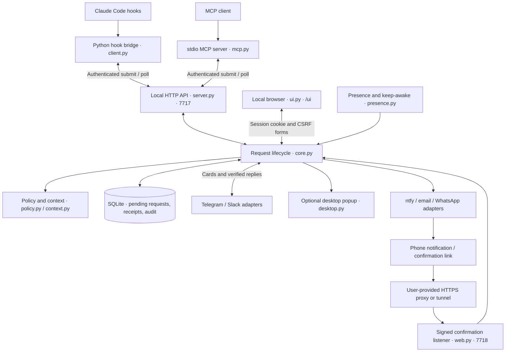

# MCPulse

**Claude Code needs you → your phone buzzes → you answer → Claude keeps working.**

Python 3.11+ implementation of the local MCPulse workflows. Version **0.3.0a1** adds a Python-rendered local dashboard to the multi-channel development build. It is not yet the complete hosted/team product or a production-certified release. See the exact [implementation status](docs/implementation-status.md).

No Node or Bun. The core and Telegram use the Python standard library; optional Slack support uses the official Python Slack SDK.

For a step-by-step preview, local setup, and recovery walkthrough, read the [setup guide](docs/setup.md).

## Quick start

Requires **Python 3.11+** and Git to clone the repository. The core runs directly from source. On Windows, replace `python3` with `py -3`; no Node, Bun, or frontend build is required.

### 1. Get the code

```sh
git clone https://github.com/pankajneema/MCPulse.git
cd MCPulse
python3 --version
```

If you already have the repository, open a terminal in its root instead. Use that same checkout and Python executable for the commands below.

### 2. Try the UI without installing integrations

```sh
python3 -m mcpulse preview
```

Keep this terminal open. The browser opens the local demo on port **7720**. Review a sample question, select an option, and send a reply to see its result receipt. This mode uses an in-memory database, changes no user configuration, sends no messages, and executes no sample commands. Ctrl-C stops it; restart to reset samples. Use `preview --port 7721` if the default port is busy.

For code development only, preview plus the [tests](#install-and-test) is sufficient. The following steps create local configuration or connect integrations when you choose to run them.

### 3. Start your local workspace

In terminal A:

```sh
python3 -m mcpulse setup
python3 -m mcpulse start
```

`setup` creates private configuration in `~/.config/mcpulse`. The daemon runs in the foreground on port **7717**. Keep terminal A open.

In terminal B, from the same repository:

```sh
python3 -m mcpulse away
python3 -m mcpulse ui
```

`away` routes waiting hook requests to your configured channels and local review flow. `ui` opens a private browser session for the running daemon. Use `--home /absolute/path` **before the subcommand** in every terminal if you want a separate configuration directory.

### 4. Verify the approval loop

In terminal B:

```sh
python3 -m mcpulse demo --kind question
```

The command waits. Refresh the dashboard, open the request, check its **Agent** and **Session ID**, and reply. The terminal prints the returned response; the browser shows **Reply saved**. Try `demo --kind permission` and `demo --kind finished` for the other flows. Demo commands do not execute tool actions, but configured channels can receive their notifications.

For a CLI-only check, open another terminal and run `python3 -m mcpulse status`, then `python3 -m mcpulse answer REQUEST_ID allow` for the sample permission request.

### 5. Add integrations when ready

Follow [Claude integration](#install-the-claude-integration) for hooks/MCP and [channel setup](#channels-and-confirmations) for Telegram, Slack, ntfy, email, or WhatsApp. Installation is separate from preview. Run [diagnostics](#check-setup-without-installing-anything) after configuring them; real delivery must be verified on your own account/device.

## Architecture

MCPulse is a **single-machine Python application**. A long-running local daemon owns request state, policy checks, delivery adapters and the dashboard. Hook/MCP client processes submit requests to it and wait for a result. A hosted relay or account service is not part of this implementation.



The diagram shows logical data flow. The local dashboard is served by the same HTTP server as the API, but uses separate browser authentication. Telegram and Slack return verified replies through their adapters; WhatsApp also accepts signed inbound webhooks through the confirmation listener. Outbound provider traffic is separate from the loopback API.

### Request lifecycle

1. The command hook or MCP tool submits a request with an ID, project, session and optional agent name. Direct HTTP hooks are also available.
2. The broker validates the payload, evaluates applicable permission rules, builds a redacted preview and persists requests that need review. Presence can return Claude hook requests to the terminal.
3. The dashboard and configured adapters present the request. Optional channel delays/quiet hours apply; one failed send does not prevent later cards from being attempted.
4. A browser form, authenticated CLI call or verified channel reply asks the broker to resolve it. Policy, preview and high-risk confirmation checks apply before approval. A shared lock makes the first accepted decision final.
5. The waiting client receives the stored response. The dashboard keeps a result receipt. Timeout, cancellation, session end and return-to-terminal close the request without granting approval.

“Reply saved” confirms local persistence, not agent delivery. Likewise, provider acceptance does not prove that a phone displayed or a person read a notification. A retry after an uncertain provider response can duplicate a notification, but cannot create a second decision for the same request.

### Components and responsibilities

| Source | Responsibility |
|---|---|
| [`cli.py`](mcpulse/cli.py), [`config.py`](mcpulse/config.py) | Commands, setup, diagnostics, private configuration and daemon startup |
| [`hooks.py`](mcpulse/hooks.py), [`client.py`](mcpulse/client.py) | Hook installation, authenticated local calls and reconnecting result polling |
| [`mcp.py`](mcpulse/mcp.py) | stdio JSON-RPC lifecycle, tools, concurrent calls and cancellation |
| [`server.py`](mcpulse/server.py) | Loopback API, event dispatch and bounded HTTP request handling |
| [`core.py`](mcpulse/core.py) | Request state, first-answer-wins, SQLite recovery, sessions, receipts and audit |
| [`policy.py`](mcpulse/policy.py), [`context.py`](mcpulse/context.py), [`replies.py`](mcpulse/replies.py) | Permission rules, bounded context, reply parsing and PIN validation |
| [`ui.py`](mcpulse/ui.py) | Python-rendered dashboard, forms, browser sessions and disposable preview |
| [`telegram.py`](mcpulse/telegram.py), [`channels.py`](mcpulse/channels.py) | Provider transports, verified senders, delivery retries and channel status |
| [`desktop.py`](mcpulse/desktop.py) | Opt-in metadata-only OS notifications, using shared delivery tracking |
| [`web.py`](mcpulse/web.py) | Signed, expiring phone confirmation links and WhatsApp webhooks |
| [`presence.py`](mcpulse/presence.py), [`service.py`](mcpulse/service.py) | Idle detection, explicit presence, keep-awake and optional OS service definitions |

### Listeners and state

| Default address | Purpose | Access |
|---|---|---|
| `127.0.0.1:7717` | Daemon API and `/ui` dashboard | API key for CLI/hooks; single-use login and session cookie for browser |
| `127.0.0.1:7718` | Optional phone confirmation/webhook listener | Signed links or verified webhooks; user supplies HTTPS hosting/proxy |
| `127.0.0.1:7720` | Disposable UI preview | Local browser login; sample data only |

The daemon stores state in `audit.sqlite3` beneath the configuration directory. SQLite WAL and a shared lifecycle lock coordinate requests. Pending payloads survive a preserved restart; completed raw payloads/detailed cards are logically cleared. Minimal receipt metadata and hook responses remain for up to 24 hours; audit metadata defaults to 30 days. Browser sessions are in memory and require a fresh login after restart. Protect state files and backups; see [security and retention](SECURITY.md).

## UI design

The interface is implemented in `ui.py` as Python-rendered HTML, shared CSS and native browser forms. It uses a light neutral background, green actions, white content panels and restrained status tags. System fonts and text icons keep the runtime independent of asset CDNs and JavaScript tooling.

| View | User task |
|---|---|
| Overview | See pending work, recent activity, presence and tracked sessions |
| Requests | Search by agent/session/project/tool/content and filter by request kind |
| Request review | Inspect Project, Agent, Session ID, full input and context; approve, deny, answer or return to terminal |
| Result receipt | See the final outcome and identity after submission; safely revisit the same request |
| Sessions | See reported projects, task context, agent names and session IDs |
| Activity | Inspect metadata events and follow request IDs to their available receipts |
| Channels | Distinguish not configured, unverified, connected and needs-attention states |

**Layout:** the desktop sidebar stays within the viewport and scrolls internally. At narrow widths it becomes normal document content and the page reflows to one column. Long request text wraps; tables can scroll within their container.

**Interaction:** native radio buttons, checkboxes and textareas support questions without client-side scripts. A written answer replaces choices for that question. Validation errors retain answers and selections but never the PIN. Successful submissions redirect to a read-only receipt, so refresh/repeated submission cannot change the original decision.

**Accessibility and feedback:** labelled controls, fieldsets/legends, keyboard focus indicators, a skip link, and status/error announcements are part of the markup. Users explicitly refresh for updates. If a connection fails after sending, the same request link lets them check whether it closed before retrying. There is no offline app shell or streaming update layer.

## Dashboard

Try the UI immediately, without configuring channels or Claude:

```sh
python3 -m mcpulse preview
```

This opens a disposable in-memory demo at port 7720 with permission, question, and completion samples. No commands execute, no messages are sent, and no user configuration is changed. Restart the preview to reset its sample data. Use `--port 7721` if needed, or `--no-open` to print the login link without launching a browser.

For the real workspace, keep `python3 -m mcpulse start` running, then in another terminal:

```sh
python3 -m mcpulse ui
```

The dashboard provides request search/filtering; full input/context review; allow, deny, and return-to-terminal actions; native question choices and written answers; follow-up/Done; session status; channel health; presence; notification pause; and metadata activity history. High-risk approval requires both your configured PIN and explicit confirmation. Presence and mute changes apply to the running daemon. Credentials and channel configuration remain in the CLI.

After an answer, the request link shows a result receipt with its agent, Session ID, and final status. Duplicate submissions keep the first decision. Validation errors retain written answers and selected options, but never the PIN. Activity IDs link back to requests/receipts. Completed receipts are available for up to 24 hours. “Reply saved” confirms local storage, not delivery to an agent. If a connection fails, reopen the same request to check its status before retrying.

The UI uses Python-rendered HTML/CSS and native browser forms, without JavaScript, Node, a frontend build, or additional runtime dependencies. Refresh to fetch new requests; it does not stream updates. The one-time login link expires after 60 seconds; an authenticated browser session lasts eight hours or until Lock/restart. If login expires, run `ui` again. The localhost dashboard is for this computer, not a remote phone endpoint or installable PWA. Phone confirmation links use the separate HTTPS listener described below.

## Install the Claude integration

After the demo works:

```sh
python3 -m mcpulse hooks install
python3 -m mcpulse mcp install
```

Restart Claude Code. Hooks cover permissions, AskUserQuestion, completion/follow-up, notifications, errors, and session events. MCP provides `ask_human`, `request_approval`, and `notify_human`.

The default hook is a Python command that submits once and polls. It can reconnect to the same persisted request after a daemon restart. `hooks install --http` selects direct HTTP hooks when persistence across the connection is unnecessary. Hook installation backs up settings, preserves unrelated hooks, and is idempotent. `hooks uninstall` restores the original bytes when there were no intervening edits; otherwise it preserves later edits and removes identifiable MCPulse hooks.

Use `--settings /absolute/project/.claude/settings.local.json` for project-local hooks. `mcp install --scope project` registers project MCP configuration through the installed Claude CLI. MCP and long hook timeouts must still be verified against your actual Claude version and environment.

## Check setup without installing anything

```sh
python3 -m mcpulse doctor
python3 -m mcpulse doctor --settings .claude/settings.local.json
python3 -m mcpulse doctor --strict --settings .claude/settings.local.json
```

`doctor` is read-only and works even before `setup`: missing or invalid configuration produces a repair hint. With a valid config, it checks the daemon and the selected Claude settings file. It detects missing/duplicate events, disabled hooks, stale command paths or HTTP credentials/ports, incorrect matchers, changed timeouts, and asynchronous permission hooks. It never prints stored credentials.

The default settings path is `~/.claude/settings.json`; pass `--settings` for project hooks. This checks that file only, not Claude's merged user/project/managed settings or account login. After installing or changing hooks, restart Claude and check its `/hooks` menu. Normal `doctor` exits successfully after producing its report; `--strict` exits 1 if a required check fails. An unavailable idle sensor is optional because explicit away/present modes work without it.

## Reply

```sh
python3 -m mcpulse status
python3 -m mcpulse answer ID allow
python3 -m mcpulse answer ID allow --confirm
python3 -m mcpulse answer ID deny --reason "Use staging"
python3 -m mcpulse answer ID always
python3 -m mcpulse answer ID edit "git diff"
python3 -m mcpulse answer ID text "My answer or next instruction"
python3 -m mcpulse answer ID done
python3 -m mcpulse answer ID handback
python3 -m mcpulse answer ID stop
```

`--confirm` is required for high-risk local approvals and high-risk edited commands. Telegram/Slack high-risk buttons use a fresh second confirmation. High-risk typed or web approvals require a PIN configured with `pin set`.

Question answers may be an option number, comma-separated indices for multi-select, or free text. Telegram advances through multiple questions. For a single atomic multi-question API/CLI answer, supply a JSON object mapping each full question to its literal answer text. This also disambiguates numeric option labels. Claude receives the original questions plus the user's answers through `updatedInput`. A reply to a finished request becomes a user instruction through the Stop hook; Done permits completion.

## Presence and services

```sh
python3 -m mcpulse present
python3 -m mcpulse away
python3 -m mcpulse auto
python3 -m mcpulse config set presence auto
python3 -m mcpulse config set keep_awake true
python3 -m mcpulse service show
python3 -m mcpulse service install
```

`present` hands waiting hook requests back to the terminal. `auto` uses native macOS/Windows idle detection, or `xprintidle` on X11. Unsupported sensors (including most Wayland/headless environments) choose present; use explicit away on a headless machine. Idle threshold defaults to 120 seconds. Explicit MCP requests can still contact you while present.

Keep-awake is opt-in: caffeinate on macOS, systemd-inhibit on Linux, and the Windows execution-state API. Availability and OS permission differ by platform. User services are generated for launchd, systemd --user, and Windows Task Scheduler. Run `service show` to inspect the exact definition; `service uninstall` removes it. Actual reboot/service validation on each OS is pending.

`start` runs in the foreground; Ctrl-C or `stop` shuts down and returns waiting hooks to Claude. `restart` preserves requests and starts the replacement in the foreground. A service manager should handle process crashes. Pending requests are persisted, expire at their original deadline, and are not silently approved after recovery. Runtime presence changes are not saved as the next startup default; set `config set presence away` or `auto` for unattended service use.

## Desktop popups

Desktop notifications are optional and **off by default**. Enable them for the real local daemon:

```sh
python3 -m mcpulse config set desktop_notifications true
python3 -m mcpulse restart
```

`restart` stays in the foreground. In another terminal, use `python3 -m mcpulse away` and `python3 -m mcpulse ui`, then try `python3 -m mcpulse demo --kind question`. The popup shows the agent, project name, session and request ID. It does not include raw commands, question text, replies or login tokens. Open the dashboard to review and answer; the popup itself has no approval buttons and does not automatically open a browser.

To disable, set `desktop_notifications` to `false` and restart. `channel list` reports the configured flag; the dashboard's Desktop row reports the running adapter status. Preview mode stays isolated and never sends native notifications.

The Python adapter calls native tools without adding Python dependencies: macOS uses AppleScript `display notification` through `osascript`, Windows uses Windows PowerShell and a temporary Windows Forms notification icon, and Linux uses `notify-send` in a graphical session. No execution-policy changes, notification permission changes or service installation are performed. References: [Apple notification scripting](https://developer.apple.com/library/archive/documentation/LanguagesUtilities/Conceptual/MacAutomationScriptingGuide/DisplayNotifications.html), [Windows notification icons](https://learn.microsoft.com/en-us/dotnet/desktop/winforms/controls/notifyicon-component-overview-windows-forms), [GNOME notify-send source](https://github.com/GNOME/libnotify/blob/master/tools/notify-send.c).

Focus/Do Not Disturb, OS notification permissions and headless/service sessions can suppress alerts even if the command succeeds. “Connected” means the adapter submitted an alert, not that it was displayed. Successfully recorded requests are not repeatedly notified across adapter restarts; ambiguous transport failures can still cause a duplicate alert. Informational/completion popups respect the notification pause; approvals and questions remain eligible. Presence rules still apply: normal Claude hooks return to the terminal in Present mode, so use Away to test the popup flow.

Native command construction, configuration, retry and deduplication paths are tested with mocked OS calls on CI. Visible native popups have not yet been verified in real macOS, Windows or Linux desktop sessions.

## Channels and confirmations

[Channel setup](docs/channels/setup.md) covers Telegram, Slack Socket Mode, ntfy, SMTP email, WhatsApp Cloud API, delayed escalation, and quiet hours. Configure channel files with:

```sh
python3 -m mcpulse channel configure slack --file /private/path/slack.json
python3 -m mcpulse channel list
python3 -m mcpulse test
```

For Telegram, stop the daemon and run `python3 -m mcpulse setup --guided`. Enter the bot token at the hidden prompt and send the displayed one-time code to the bot in a private chat. Restart the daemon, switch to `away`, then try a demo. For Slack, install the optional SDK using the same Python environment (`python3 -m pip install '.[slack]'`), prepare the [Slack configuration](examples/slack.json), and follow the [channel guide](docs/channels/setup.md) before configuring it.

`test` queues a notification; it does not prove delivery. `doctor` and `status` report daemon/channel state. Optional adapters remain **unverified** until a send/update succeeds in the current run. Failed deliveries retry independently, while successful stored references avoid routine resends. Channel cards include agent and session metadata.

Email, WhatsApp links, and actionable ntfy notifications use a separate confirmation listener. Set `web_origin` to your own HTTPS tunnel/reverse-proxy origin pointing to loopback port **7718**. Never expose daemon API port **7717**. GET renders a review page; only a confirmed POST can answer. Links are signed, action-bound, short-lived, and single-use through the request lifecycle. The confirmation listener is not a cloud relay or PWA.

## Rules, context, and audit

By default, decisions require a human except for built-in hard-deny patterns. Exact low/medium-risk actions can be remembered per project. No executable-prefix wildcard is remembered. High-risk, compound, masked, shortened, or disguised requests cannot be remembered or silently allowed. Changed previews require the terminal.

User rules live at `MCPULSE_HOME/rules.json`. `tool` and `match` are regular expressions. Project rules at `.mcpulse/rules.json` load only after explicit `rules trust /absolute/project`; never trust a repository you do not control. Regex evaluation runs in a bounded subprocess so pathological patterns cannot hang the daemon. Denies override remembered/configured allows, and high-risk requests still require a human. See `examples/rules.json`.

```sh
python3 -m mcpulse rules test "git push --force origin main"
python3 -m mcpulse rules list
python3 -m mcpulse rules forget /absolute/project
python3 -m mcpulse audit
python3 -m mcpulse audit --csv > audit.csv
python3 -m mcpulse config set daily_digest_hour 18
```

Context reads at most the tail of a JSONL transcript beneath `~/.claude`, plus a local Git branch lookup. It shows recent task/message/steps when that evidence is available. No arbitrary transcript path outside Claude's directory is read. Redaction is best-effort.

Configuration defaults to `~/.config/mcpulse`; `MCPULSE_HOME` or `--home /path` changes it. POSIX configuration/token/state files are private; no OS keychain integration or Windows ACL hardening is claimed. Audit is metadata only, with a configurable 30-day default retention. Open request payloads are stored in private SQLite for recovery, then logically cleared on completion; minimal receipt metadata (request ID, project, agent, session) and completed hook responses remain for at most 24 hours to support retry. **Pending payloads and returned answers can contain secrets**; protect this directory and its backups. SQLite/WAL snapshots may retain deleted bytes. Read [SECURITY.md](SECURITY.md).

## Install and test

```sh
python3 -m venv .venv
.venv/bin/python -m pip install '.[slack]'
.venv/bin/mcpulse --help
.venv/bin/python -m unittest discover -v
```

Omit `[slack]` for a core install without runtime dependencies. On Windows use `.venv\Scripts\python` and `.venv\Scripts\mcpulse`. Run directly from source with `python3 -m mcpulse` if you do not want an installation.

The current suite contains **107 tests**, including optional Slack SDK checks. [GitHub CI](https://github.com/pankajneema/MCPulse/actions/workflows/ci.yml) runs Python 3.11 and 3.14 on Linux, macOS and Windows.

Tests use temporary homes, real loopback HTTP, subprocess CLI/MCP sessions, SQLite recovery, signed confirmation pages, and mocked provider transports. They do not send real messages, install services, or alter your Claude settings. Optional Slack tests use its installed SDK without connecting to a workspace.

The [original brief](docs/product-spec.md) is preserved. The user-requested Python stack supersedes its TypeScript/Bun choice. Hosted auth/relay/PWA, multi-machine accounts, teams, billing, other agent adapters, release signing, and external validation remain tracked separately; they are not represented as completed features.

### Agent labels and session IDs

Request details show the agent and Session ID. Claude hooks default to `Claude CLI`; MCP requests use the client name from initialization and an MCPulse-generated connection session ID. API callers can provide an optional `agent` string (1–100 characters), such as `claude-cli`, `claude-cowork`, or `opencode`. Names are display metadata supplied by the sender, not verified identities or proof of a dedicated integration. Cowork/OpenCode adapters are not installed or implied by these labels.
